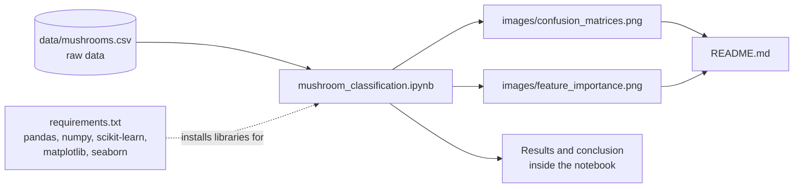
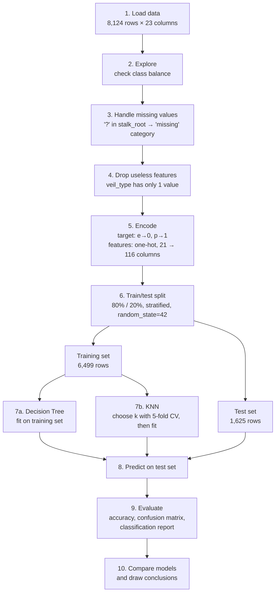
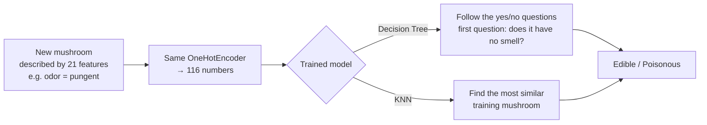

# 🍄 Mushroom Classification: Edible or Poisonous?

A beginner machine-learning project that predicts whether a mushroom is **edible** or **poisonous** from its physical characteristics. It compares a **Decision Tree** with **K-Nearest Neighbors (KNN)**.

> ⚠️ This is a learning exercise. **Never** eat a wild mushroom based on a model's prediction.

## Table of contents
1. [Project overview](#project-overview)
2. [Dataset](#dataset)
3. [Project architecture](#project-architecture)
4. [ML pipeline](#ml-pipeline)
5. [Setup](#setup)
6. [Results](#results)
7. [Conclusion](#conclusion)
8. [Limitations and next steps](#limitations-and-next-steps)

## Project overview

| Step | What happens in the notebook |
|---|---|
| **1. Idea** | Predict `edible` / `poisonous` from 22 observable features (odour, cap colour, gill size, spore print colour, habitat, …). A model like this shows which features matter most for telling dangerous mushrooms apart. |
| **2. Data preparation** | Load the CSV, check class balance, handle missing values, drop useless columns, encode the features and target, and split into train/test sets. |
| **3. Model building** | **Decision Tree** and **KNN**, with *k* chosen by 5-fold cross-validation. |
| **4. Evaluation** | Test accuracy, cross-validation accuracy, confusion matrices, classification reports and feature importances. |
| **5. Conclusion** | Which model won and what I learned. |

Notebook: [`mushroom_classification.ipynb`](mushroom_classification.ipynb)

## Dataset

- **Source:** [UCI Machine Learning Repository: Mushroom Data Set](https://archive.ics.uci.edu/dataset/73/mushroom) (also on [Kaggle](https://www.kaggle.com/datasets/uciml/mushroom-classification))
- **Copy used here:** [`data/mushrooms.csv`](data/mushrooms.csv)
- **Size:** 8,124 mushrooms × 23 columns (1 target `type` + 22 categorical features)
- **Classes:** 4,208 edible (51.8%) / 3,916 poisonous (48.2%)
- **Input format:** every feature is a single-letter code (for example, `odor`: `a` = almond, `f` = foul, `n` = none). The model needs these descriptions, not photos. Some key features, such as odour and spore print colour, can't be seen in a picture.

## Project architecture

### Folder structure
```
mushroom-classification/
├── mushroom_classification.ipynb   # main notebook: the full pipeline, with outputs
├── data/
│   └── mushrooms.csv               # raw dataset (input)
├── images/
│   ├── confusion_matrices.png      # generated by the notebook (output)
│   └── feature_importance.png      # generated by the notebook (output)
├── requirements.txt                # Python dependencies
├── .gitignore
└── README.md
```

### Component overview



| Component | Role | Tools |
|---|---|---|
| **Data layer** | Stores the raw dataset as a CSV file | `data/mushrooms.csv` |
| **Processing layer** | Cleans and encodes the data | `pandas`, `scikit-learn` (`OneHotEncoder`, `LabelEncoder`, `train_test_split`) |
| **Model layer** | Trains and tunes the two classifiers | `scikit-learn` (`DecisionTreeClassifier`, `KNeighborsClassifier`, `cross_val_score`) |
| **Evaluation layer** | Measures and visualises performance | `scikit-learn.metrics`, `matplotlib`, `seaborn` |
| **Output layer** | Saves figures and reports results | `images/`, notebook outputs, `README.md` |

## ML pipeline

### Pipeline diagram



### Pipeline stages in detail

| # | Stage | What it does | Why |
|---|---|---|---|
| 1 | **Load data** | Reads `data/mushrooms.csv` into a pandas DataFrame | Starting point of the pipeline |
| 2 | **Explore** | Counts edible vs poisonous mushrooms | Balanced classes (52/48) mean accuracy is a fair metric |
| 3 | **Handle missing values** | Finds 2,480 `?` values in `stalk_root` and replaces them with the category `missing` | Missing values here aren't `NaN`. Dropping 30% of the rows would waste data |
| 4 | **Drop useless features** | Removes `veil_type` | A column with a single value carries no information |
| 5 | **Encode** | `LabelEncoder` on the target, `OneHotEncoder` on the 21 features (→ 116 binary columns) | Models need numbers. One-hot avoids a fake order between categories, which matters for KNN's distance calculation |
| 6 | **Split** | 80% train / 20% test, stratified | The test set is kept hidden to measure performance on unseen mushrooms. Stratifying keeps the class ratio the same in both sets |
| 7a | **Decision Tree** | Learns a flowchart of yes/no questions about the features | Interpretable, fast, needs no scaling |
| 7b | **KNN** | Tests k = 1, 3, …, 15 with 5-fold cross-validation, picks the best (k = 1), then stores the training set | Labels a mushroom like its most similar known mushroom(s) |
| 8 | **Predict** | Both models predict the 1,625 test mushrooms | Simulates mushrooms the models have never seen |
| 9 | **Evaluate** | Accuracy, confusion matrix, precision/recall, feature importance | The confusion matrix shows the dangerous error: poisonous predicted as edible |
| 10 | **Compare** | Side-by-side table and plots | Decide which model to recommend |

### How a single prediction works


## 🌐 Web app (frontend)

The project includes a small website where anyone can describe a mushroom and see what **both models** predict, along with **why**: the Decision Tree's questions step by step and the most similar mushrooms KNN found.

**Live demo:** https://YOUR-USERNAME.github.io/mushroom-classification/

### Features
- **Classify a mushroom:** 21 questions grouped by part of the mushroom (smell, cap, gills, stalk, ring, habitat). The verdict updates live as you answer.
- **Explainable results:** the Decision Tree shows every yes/no question it asked, and KNN shows its 5 closest training mushrooms and how many answers match.
- **Try real examples:** load a random edible or poisonous mushroom from the test set (never seen during training) and check whether the models get it right.
- **Safety-first design:** if the models disagree, the verdict is "Treat as poisonous", and unusual combinations get a warning.
- **Results page:** accuracy, cross-validation scores, confusion matrices and the most useful features.
- Works on phones and desktops, has light and dark themes, and runs entirely in the browser (no server, nothing is sent anywhere).

### How it works
The website is plain **HTML + CSS + JavaScript**, with no frameworks and nothing to install.

```
export_model.py   →   docs/model.js   →   docs/app.js   →   docs/index.html
(trains the models      (trained models     (runs the models     (the page you
 like the notebook)      saved as data)      in the browser)      see)
```

| File | What it does |
|---|---|
| `export_model.py` | Repeats the notebook's data preparation and training (same split, same `random_state=42`), then saves the Decision Tree, the KNN training mushrooms, the test examples and the results into `docs/model.js` |
| `docs/index.html` | Page structure: classifier, "How it works", results and about sections |
| `docs/style.css` | The design: colours, layout, light/dark themes, mobile layout |
| `docs/app.js` | The logic: builds the form, runs the Decision Tree and KNN on your answers, and shows the explanation |
| `docs/model.js` | The trained models as data (generated, so don't edit it by hand) |

The JavaScript version of both models was checked against all 1,625 test mushrooms and gives the same answers as scikit-learn (100% accuracy for both).

### Run it locally
Just open `docs/index.html` in your browser (double-click it).

To rebuild `docs/model.js` after changing the model:
```bash
python export_model.py
```

## Setup

```bash
git clone https://github.com/chiranshee26-source/mushroom-classification.git
cd mushroom-classification

python -m venv .venv
source .venv/bin/activate          # Windows: .venv\Scripts\activate
pip install -r requirements.txt

jupyter notebook mushroom_classification.ipynb
```

Then run **Kernel → Restart Kernel and Run All Cells**. The dataset is included in the repo, so no download is needed.

## Results

| Model | Test accuracy | 5-fold CV accuracy (train) |
|---|---|---|
| Decision Tree | **100.00%** | 99.97% |
| KNN (k = 1) | **100.00%** | **100.00%** |
| *Decision Tree limited to depth 3 (for interpretation)* | *98.22%* | – |


Both models classify all 1,625 test mushrooms correctly. Most importantly, **no poisonous mushroom is predicted as edible**.


`odor_n` (the mushroom has **no smell**) is by far the most informative feature (~62% of the tree's importance), followed by `stalk_root_c` and `stalk_surface_below_ring_y`.

## Conclusion

- **Which model performed better?** Both reached 100% test accuracy. KNN was marginally better in cross-validation (100% vs 99.97%, about 2 mushrooms out of 6,499), so on accuracy alone **KNN wins by a hair**, but in practice the two are tied.
- **Which would I use?** The **Decision Tree**. It is interpretable (you can read its rules, which matters when a mistake can be deadly), it predicts faster (KNN compares each new mushroom against every training sample), and it needs no tuning of *k*.
- **What I learned**
  - Missing values aren't always `NaN`: this dataset hides them as `?`.
  - Categorical features need encoding. One-hot encoding avoids inventing a fake order, which matters a lot for distance-based models like KNN.
  - Remove columns with a single value (`veil_type`).
  - Smell is the strongest single clue: a tree that asks only 3 questions already gets ~98% accuracy.
  - Perfect accuracy should make you suspicious. Here it's genuine because the dataset is very separable, but in a safety-critical task the count of *poisonous predicted as edible* matters more than overall accuracy.

## Limitations and next steps

- **Limited species:** the data covers only 23 species from the Agaricus and Lepiota family. Mushrooms outside the dataset may be misclassified with full confidence.
- **No photos:** the model needs a written description of 21 features, some of which (odour, spore print) can't be captured in a picture.
- **Possible improvements:**
  - Wrap the encoder and model in a single scikit-learn `Pipeline` so the same preprocessing is always applied.
  - Save the trained model with `joblib` and build a simple input form that predicts from a user's answers.
  - Try other models (Logistic Regression, Random Forest) and compare them.
  - For photo-based prediction, collect a labelled image dataset and train a Convolutional Neural Network (CNN).
