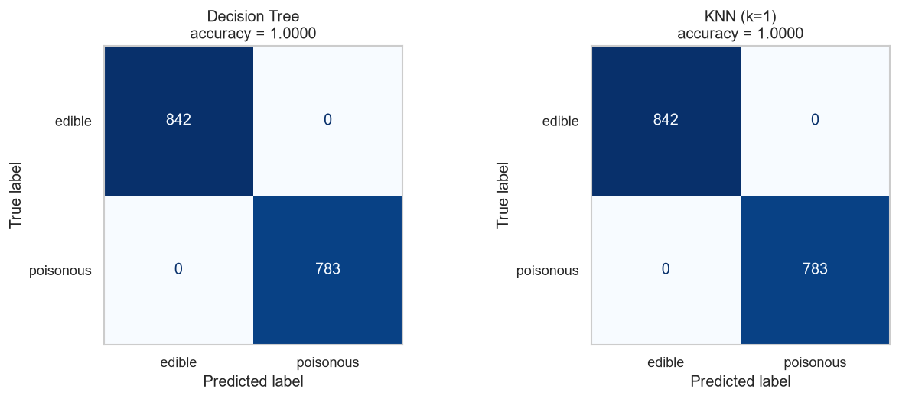
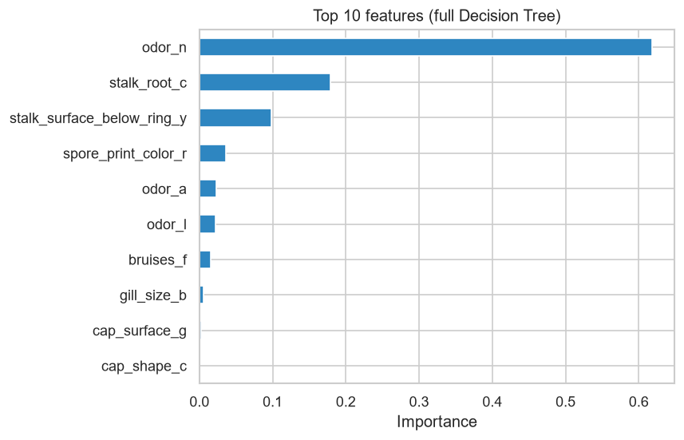

# 🍄 Mushroom Classification: Edible or Poisonous?

A beginner machine-learning project that predicts whether a mushroom is **edible** or **poisonous** from its physical characteristics. It compares a **Decision Tree** with **K-Nearest Neighbors (KNN)**.

> ⚠️ This is a learning exercise. **Never** eat a wild mushroom based on a model's prediction.

## Project overview

| Step | What happens in the notebook |
|---|---|
| **1. Idea** | Predict `edible` / `poisonous` from 22 observable features (odour, cap colour, gill size, spore print colour, habitat, …). A model like this shows which features matter most for telling dangerous mushrooms apart. |
| **2. Data preparation** | Load the CSV, check class balance, find missing values (stored as `?` in `stalk_root`, 2,480 rows) and keep them as a `missing` category, drop the constant column `veil_type`, label-encode the target, one-hot encode the 21 features (116 binary columns), and make a stratified 80/20 train/test split. |
| **3. Model building** | **Decision Tree** (`DecisionTreeClassifier`) and **KNN** (`KNeighborsClassifier`), with *k* chosen by 5-fold cross-validation. |
| **4. Evaluation** | Test accuracy, 5-fold CV accuracy, confusion matrices, classification reports, a depth-3 tree visualisation and feature importances. |
| **5. Conclusion** | Which model won and what I learned (see below). |

Notebook: [`mushroom_classification.ipynb`](mushroom_classification.ipynb)

## Dataset

- **Source:** [UCI Machine Learning Repository: Mushroom Data Set](https://archive.ics.uci.edu/dataset/73/mushroom) (also on [Kaggle](https://www.kaggle.com/datasets/uciml/mushroom-classification))
- **Copy used here:** [`data/mushrooms.csv`](data/mushrooms.csv) (from [stedy/Machine-Learning-with-R-datasets](https://github.com/stedy/Machine-Learning-with-R-datasets/blob/master/mushrooms.csv))
- **Size:** 8,124 mushrooms × 23 columns (1 target `type` + 22 categorical features)
- **Classes:** 4,208 edible (51.8%) / 3,916 poisonous (48.2%)

## Setup

```bash
git clone <this-repo-url>
cd mushroom-classification

python -m venv .venv
source .venv/bin/activate          # Windows: .venv\Scripts\activate
pip install -r requirements.txt

jupyter notebook mushroom_classification.ipynb
```

Then run **Kernel → Restart & Run All**. The dataset is included in the repo, so no download is needed.

## Results

| Model | Test accuracy | 5-fold CV accuracy (train) |
|---|---|---|
| Decision Tree | **100.00%** | 99.97% |
| KNN (k = 1) | **100.00%** | **100.00%** |
| *Decision Tree limited to depth 3 (for interpretation)* | *98.22%* | – |



Both models classify all 1,625 test mushrooms correctly. Most importantly, **no poisonous mushroom is predicted as edible**.



`odor_n` (the mushroom has **no smell**) is by far the most informative feature (~62% of the tree's importance), followed by `stalk_root_c` and `stalk_surface_below_ring_y`.

## Conclusion

- **Which model performed better?** Both reached 100% test accuracy. KNN was marginally better in cross-validation (100% vs 99.97%, about 2 mushrooms out of 6,499), so on accuracy alone **KNN wins by a hair**, but in practice the two are tied.
- **Which would I use?** The **Decision Tree**. It is interpretable (you can read its rules, which matters when a mistake can be deadly), it predicts faster (KNN compares each new mushroom against every training sample), and it needs no tuning of *k*.
- **What I learned**
  - Missing values aren't always `NaN`: this dataset hides them as `?`.
  - Categorical features need encoding. One-hot encoding avoids inventing a fake order, which matters a lot for distance-based models like KNN.
  - Remove columns with a single value (`veil_type`).
  - Smell is the strongest single clue: a tree that asks only 3 questions already gets ~98% accuracy.
  - Perfect accuracy should make you suspicious. Here it's genuine because the dataset is very separable, but in a safety-critical task the count of *poisonous predicted as edible* matters more than overall accuracy.

## Repository structure

```
mushroom-classification/
├── mushroom_classification.ipynb   # main notebook (executed, with outputs)
├── data/mushrooms.csv              # dataset
├── images/                         # figures used in this README
├── requirements.txt
└── README.md
```
